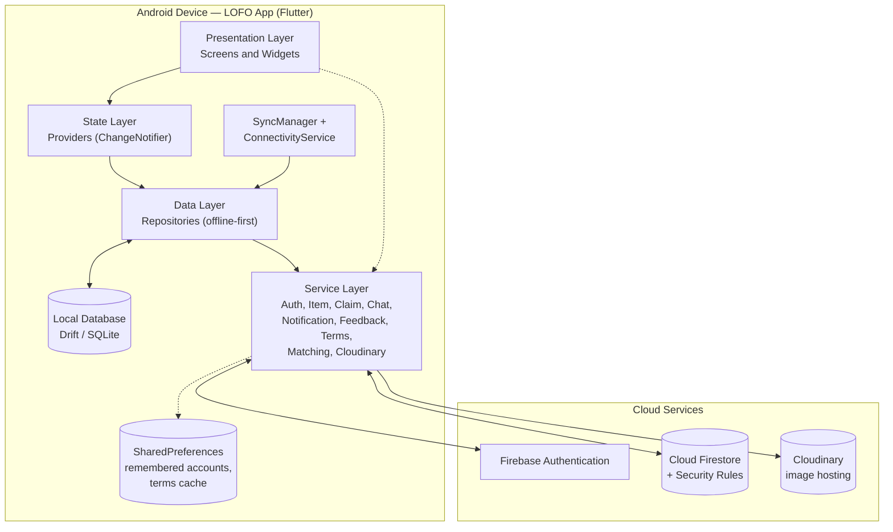
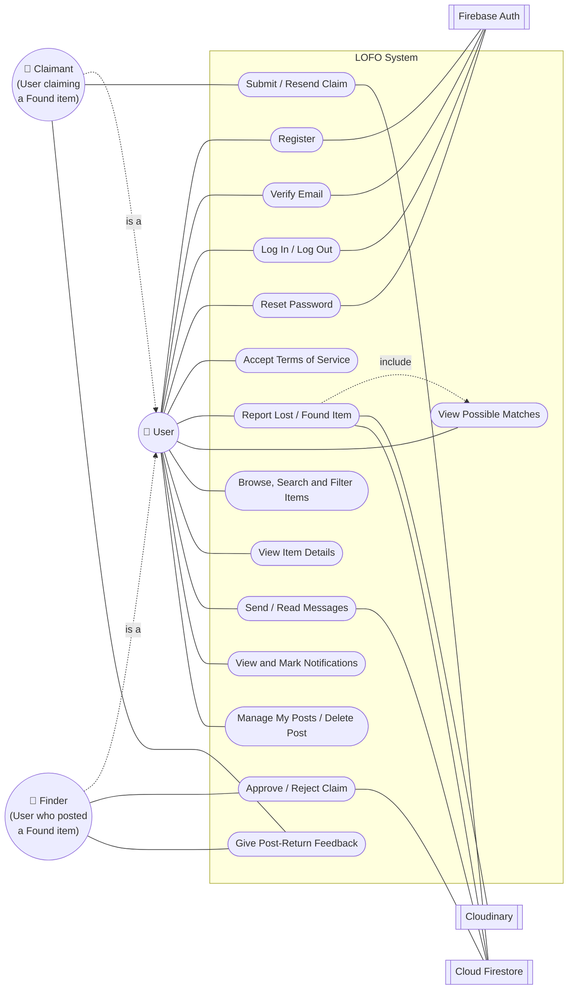
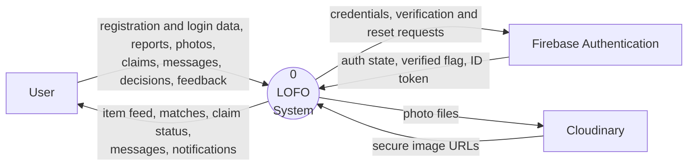
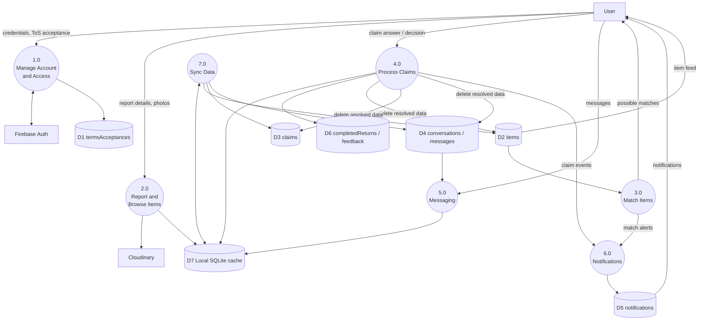
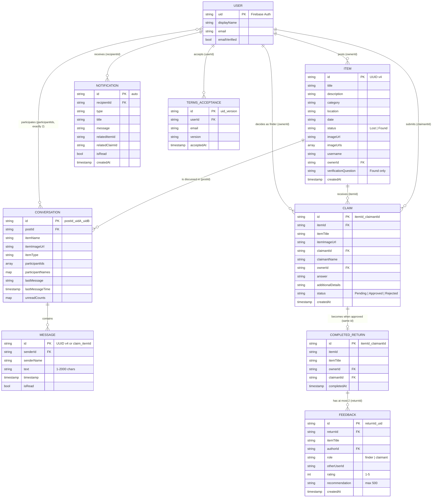
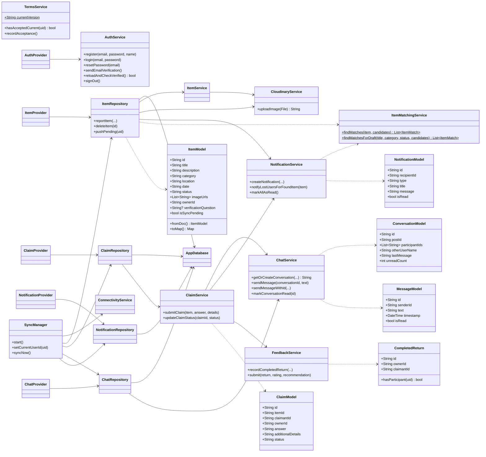
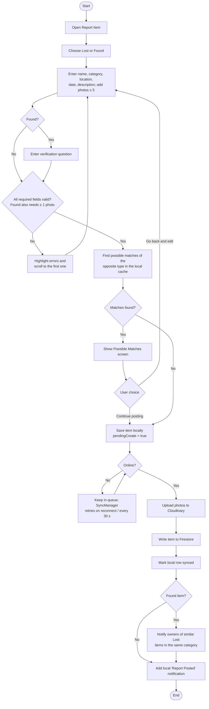
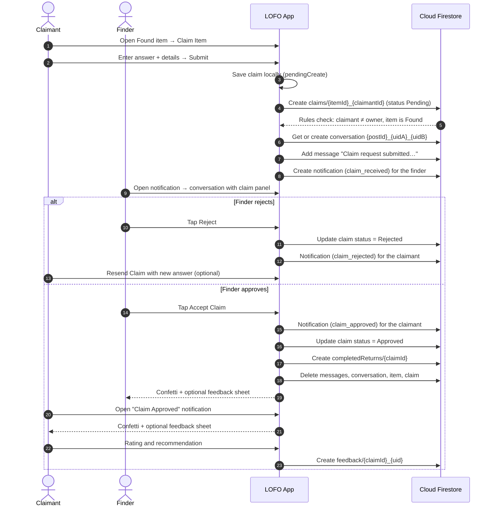
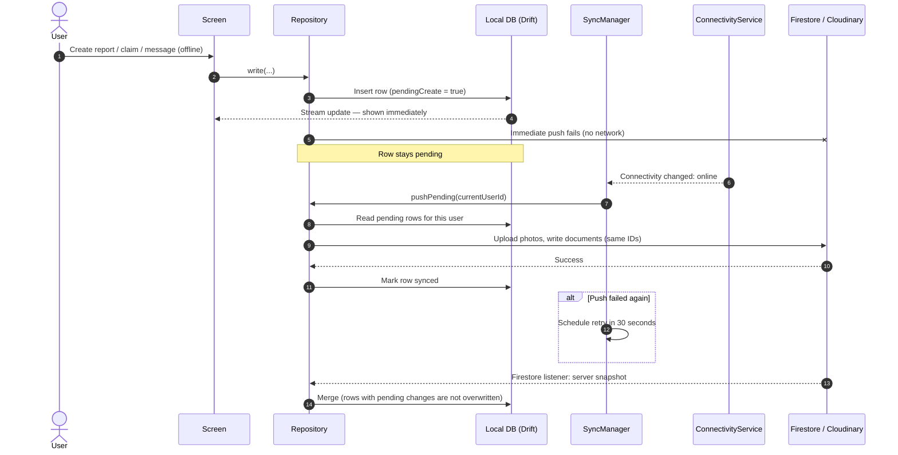
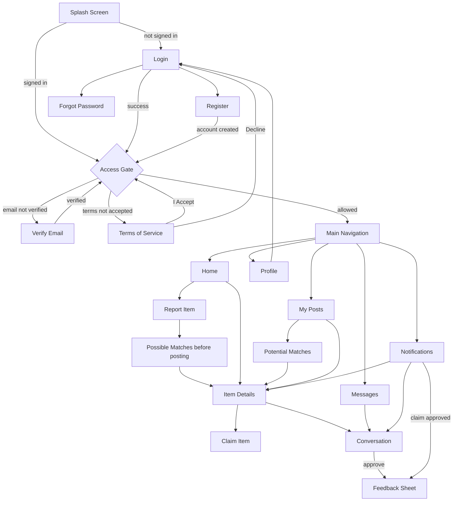

# Chapter 3 — Methodology and System Design

> The diagrams are written in **Mermaid**. They display as images on GitHub, in VS Code with a Mermaid extension, or at https://mermaid.live, where you can export them as PNG or SVG for Word. Every diagram was drawn from the actual source code (`lib/`) and from `firestore.rules`.

---

## 3.1 Software Development Methodology

> **Your input is needed.** I cannot tell from the code which methodology you followed. Name the method you actually used and describe what you did in each phase.

[[METHODOLOGY NAME, e.g., Agile (Scrum) / Iterative and Incremental / Prototyping / Waterfall]]

**Evidence that you can cite from the project.** The git history shows development work from **October 2 to October 18, 2026** in these commits:

| Date | Commit summary |
|---|---|
| 2026-10-02 | Initial commit |
| 2026-10-04 | Fixed Firestore rules |
| 2026-10-04 | Item matching (name keyword and category) on submit; "Check matches" in My Posts; possible-match notifications; notification linking |
| 2026-10-04 | Resend button for rejected claims |
| 2026-10-13 | User-interface improvements |
| 2026-10-17 | Backup before additional features |
| 2026-10-17 | Registration verification, user agreement, multiple photos, Lost items without a photo, notification badge, mark notifications as read, confetti animation, user feedback |
| 2026-10-18 | Backup: UI refinements across the screens, shared feedback widgets (`app_feedback.dart`), theme updates (commit `6b4124c`, the version documented here) |

**Figure 2. Development Methodology.** [[Insert a diagram of your chosen methodology.]]

**Template (replace with what actually happened):**

| Phase / Sprint | Dates | Activities | Output |
|---|---|---|---|
| [[Planning]] | [[ ]] | [[ ]] | [[ ]] |
| [[Analysis / Requirements]] | [[ ]] | [[ ]] | [[ ]] |
| [[Design]] | [[ ]] | [[ ]] | [[ ]] |
| [[Development: iteration 1]] | [[ ]] | [[ ]] | [[ ]] |
| [[Testing]] | [[ ]] | [[ ]] | [[ ]] |
| [[Deployment / Evaluation]] | [[ ]] | [[ ]] | [[ ]] |

---

## 3.2 Requirements-Gathering Methods *(conditional)*

> **Keep this section only if you actually gathered requirements** through interviews, surveys, observation or document review. Give the number of respondents, the dates and the instruments used. If you did not, delete the section and add one sentence to 3.3: *"The requirements were defined by the researchers based on the problem analysis and the review of related systems."*

[[DESCRIBE METHODS, RESPONDENTS AND DATES — or delete this section]]

---

## 3.3 System Requirements

Every requirement below is satisfied by the current source code unless it says otherwise.

### Functional Requirements

**Table 2. Functional Requirements**

| ID | Requirement | Status |
|---|---|---|
| FR-01 | The system shall let a user register with full name, email and password (password entered twice for confirmation). | Implemented |
| FR-02 | The system shall send an email-verification link after registration and allow the user to resend it. | Implemented |
| FR-03 | The system shall let a user log in, log out, and request a password-reset email. | Implemented |
| FR-04 | The system shall remember accounts previously used on the device (no passwords) for quick sign-in, and let the user remove them. | Implemented |
| FR-05 | The system shall require acceptance of the current Terms of Service version and record each acceptance. | Implemented |
| FR-06 | The system shall block access to the main app until the email is verified and the Terms are accepted. | Implemented |
| FR-07 | The system shall let a user report an item as Lost or Found with name, category, location, date, description and up to 5 photos. | Implemented |
| FR-08 | The system shall require at least one photo and a verification question for Found reports. Photos are optional for Lost reports. | Implemented |
| FR-09 | The system shall show possible matches of the opposite type before a report is submitted. | Implemented |
| FR-10 | The system shall display other users' posts and support search (name, category, location) and filters (type, category). | Implemented |
| FR-11 | The system shall show item details with all photos in a full-screen viewer. | Implemented |
| FR-12 | The system shall let a user submit one claim per Found item by answering the verification question, with optional additional details. | Implemented |
| FR-13 | The system shall let the finder approve or reject a claim, and let the claimant resend a rejected claim. | Implemented |
| FR-14 | When a claim is approved, the system shall record a completed return and delete the item, the claim, the conversation and its messages. | Implemented |
| FR-15 | The system shall provide private one-to-one messaging per post, with unread counts. | Implemented |
| FR-16 | The system shall create in-app notifications for claim events and possible matches, and let the user mark one or all as read. | Implemented |
| FR-17 | The system shall list the user's own posts, filter them, delete them, and check matches for each one. | Implemented |
| FR-18 | The system shall let both participants of a completed return submit one optional rating (1–5) and recommendation (up to 500 characters). | Implemented |
| FR-19 | The system shall save reports, deletions, claims, messages and read-status changes made offline, and sync them when online. | Implemented |
| FR-20 | The system shall let a user edit an existing post. | **Not implemented** (shows "will be implemented later") |
| FR-21 | The system shall let a user edit their profile and change their password inside the app. | **Not implemented** (shows "coming soon") |
| FR-22 | The system shall let a user report an inappropriate post, and support warnings and temporary posting bans. | **Planned** (rules only; no app screen or moderation component) |

### Non-Functional Requirements

**Table 3. Non-Functional Requirements**

| ID | Category | Requirement | How the system addresses it |
|---|---|---|---|
| NFR-01 | Security | Only verified users who have accepted the Terms can read or write protected data. | `hasAccess()` in `firestore.rules` checks the signed ID token and the acceptance record. |
| NFR-02 | Security | Users can change only data they own or are involved in. | Ownership and participant checks on every collection; deny by default. |
| NFR-03 | Privacy | Claim answers and chats are visible only to the two users involved and are deleted after a return. | Claim and conversation rules; cleanup in `ClaimService`. |
| NFR-04 | Privacy | No passwords are stored on the device. When an account logs out, its cached data is not shown to the next account. | `RememberedAccount` stores no secrets; `clearUserScopedCacheOnLogout`. |
| NFR-05 | Availability | The app remains usable without an internet connection. | Drift local database, offline queue, `SyncManager`. |
| NFR-06 | Reliability | Offline actions are never lost or duplicated during sync. | Pending flags, IDs generated on the device, idempotent message send, 30-second retry. |
| NFR-07 | Integrity | One user cannot create duplicate claims or duplicate feedback. | Deterministic document IDs plus create-only rules. |
| NFR-08 | Usability | Forms show clear errors, and the screens follow Material Design. | Field-level validation and scroll-to-error in the report form; `AppTheme`. |
| NFR-09 | Performance | [[Only if measured: state the target and the measured value]] | No performance measurement has been done yet. |
| NFR-10 | Portability | Runs on Android phones. | Flutter build for Android. |

---

## 3.4 System Architecture

LOFO uses a **layered, offline-first client architecture** with cloud services. It has **no custom backend server**. The application talks directly to Firebase and Cloudinary, and Firestore Security Rules enforce security on the server.

**Figure 3. System Architecture of LOFO**

**Description of the layers:**

1. **Presentation layer** (`lib/screens`, `lib/widgets`): the Flutter screens and reusable widgets.
2. **State layer** (`lib/providers`): the `AuthProvider`, `ItemProvider`, `ClaimProvider`, `ChatProvider` and `NotificationProvider` classes. They hold screen state such as filters and badge counts, and notify the UI when data changes.
3. **Data layer** (`lib/data/repositories`): the repositories. They write every change to the local database first and then try to send it to the cloud. They also listen to Firestore and copy server data into the local database.
4. **Local database** (`lib/data/local`): a Drift (SQLite) database. **The UI reads from this database**, so screens load even when the device is offline.
5. **Service layer** (`lib/services`): the classes that call Firebase Authentication, Cloud Firestore and the Cloudinary upload API. The pure-Dart matching algorithm also lives here.
6. **Sync layer** (`lib/data/sync`): `SyncManager` sends queued changes at start-up, whenever the connection returns, and every 30 seconds while work is still pending.
7. **Cloud**: Firebase Authentication (accounts), Cloud Firestore (shared data, protected by Security Rules) and Cloudinary (photos).

---

## 3.5 Use-Case Diagram

LOFO has **one human actor, the User**. A user acts as a *Finder* when they own a Found post, and as a *Claimant* when they claim someone else's Found post. The app has **no Administrator actor**. The external systems are shown as secondary actors.

**Figure 4. Use-Case Diagram**

**Table 4. Use-Case Descriptions (main use cases)**

| Use case | Actor | Precondition | Main flow | Postcondition |
|---|---|---|---|---|
| Register | User | None | The user enters full name, email, password and confirmation → the account is created → a verification email is sent | The account exists but is unverified |
| Verify Email | User | Registered | The user opens the link in the email → taps "I've Verified My Email" → the app reloads the user and refreshes the ID token | Email verified |
| Accept Terms | User | Verified | The user reads the Terms (v1.0) → taps *I Accept* → an acceptance record is created | The user can enter the app |
| Report Item | User | Has access | The user fills in the form → the app shows possible matches → the user continues → the item is saved locally and synced | The item is visible to others after sync |
| Submit Claim | Claimant | Found item owned by another user | The claimant answers the verification question and adds details → submits | A Pending claim exists; a claim message and a notification go to the finder |
| Approve / Reject Claim | Finder | A Pending claim exists | In the conversation, the finder taps *Accept Claim* or *Reject* | Approve: completed return recorded, data deleted, claimant notified. Reject: claimant notified and can resend |
| Give Feedback | Finder / Claimant | A completed return exists | The user gives a rating of 1–5 and an optional recommendation | One feedback record per user per return |

---

## 3.6 Data-Flow Diagrams

**Figure 5. Context Diagram (Level 0)**

**Figure 6. Level-1 DFD**

---

## 3.7 Entity-Relationship Diagram

Cloud Firestore is a **NoSQL document database**. It has no tables or foreign keys. The diagram below is a **logical ERD**: the "relationships" are ID fields stored inside documents (for example, `ownerId` holds a Firebase Auth user ID). **USER** represents the Firebase Authentication account. The app does **not** store a user-profile collection.

**Figure 7. Logical ERD**

> **Not shown:** the collections `reports` and `users` (with `bannedUntil`) exist **only in the Security Rules** for the planned moderation feature. The app never reads or writes them, except that the rules check `users/{uid}` when a user creates or updates an item.

---

## 3.8 Database Design

### 3.8.1 Cloud Firestore Data Dictionary

**Table 5. `items`**: Lost and Found posts. Document ID: UUID v4 generated on the device.

| Field | Type | Constraint / Rule | Description |
|---|---|---|---|
| title | string | Required in the form | Item name |
| description | string | Required | Item description |
| category | string | One of: Electronics, Wallet, ID, Keys, Books, Others | Category |
| location | string | One of: Library, Classroom, Laboratory, Cafeteria, Gymnasium, Main Building, Other | Where the item was lost or found |
| date | string | Date chosen in the form | Date lost or found (stored as text) |
| status | string | `Lost` or `Found` (`Pending` is a legacy value treated as Found) | Report type |
| imageUrl | string | May be empty for Lost items | First photo (kept for older posts) |
| imageUrls | array<string> | 0–5 URLs | All photo URLs (Cloudinary) |
| username | string | | Poster's display name |
| ownerId | string | Must equal the signed-in user (rules) | Poster's user ID |
| verificationQuestion | string / null | Required for Found | Question that the claimant must answer |
| createdAt | timestamp | | Creation time |

**Table 6. `claims`**: Document ID: `{itemId}_{claimantId}` (one claim per user per item).

| Field | Type | Constraint / Rule | Description |
|---|---|---|---|
| itemId | string | Item must exist and be Found | Claimed item |
| itemTitle, itemImageUrl | string | Cannot change after creation | Copy of item info for display |
| claimantId | string | Must equal the signed-in user | Claimant |
| claimantName | string | | Claimant's display name |
| ownerId | string | Must equal the item's owner; cannot be the claimant | Finder |
| answer | string | Claimant may change it only when resending | Answer to the verification question |
| additionalDetails | string | Same as above | Extra proof of ownership |
| status | string | `Pending`, `Approved`, `Rejected` | Claim state |
| createdAt | timestamp | Cannot change | Submission time |

**Table 7. `conversations`**: Document ID: `{postId}_{uidA}_{uidB}`, with the two user IDs sorted.

| Field | Type | Constraint / Rule | Description |
|---|---|---|---|
| postId | string | Cannot change | Related item |
| itemName, itemImageUrl, itemType | string | Cannot change | Item info for the chat header |
| participantIds | array<string> | Exactly 2 different users, including the creator | Participants |
| participantNames | map | | Display names by user ID |
| lastMessage | string | Updatable | Preview text |
| lastMessageTime | timestamp | Updatable | For sorting |
| unreadCounts | map<uid,int> | Updatable | Unread messages per participant |

**Table 8. `conversations/{id}/messages`**

| Field | Type | Constraint / Rule | Description |
|---|---|---|---|
| senderId | string | Must equal the signed-in user | Sender |
| senderName | string | | Sender's name |
| text | string | 1–2000 characters | Message body |
| timestamp | timestamp | Cannot change | Send time |
| isRead | bool | Created as false; only the recipient may set it to true | Read flag |

**Table 9. `notifications`**: Document ID: auto-generated by Firestore.

| Field | Type | Constraint / Rule | Description |
|---|---|---|---|
| recipientId | string | Only the recipient can read or delete it | Receiver |
| type | string | Clients may create: `match`, `category_match`, `claim_received`, `claim_approved`, `claim_rejected`, `claim_update`, `message` | Event type (the app currently creates `category_match` and the three `claim_*` events) |
| title, message | string | | Display text |
| relatedItemId, relatedClaimId | string / null | | Links used when the notification is tapped |
| isRead | bool | The only field that may be updated | Read flag |
| createdAt | timestamp | | Creation time |

**Table 10. `termsAcceptances`**: Document ID: `{uid}_{version}`. Create-only.

| Field | Type | Rule |
|---|---|---|
| userId | string | Must equal the signed-in user |
| email | string | Must equal the token's email (case-insensitive) |
| version | string | Must equal the current version (`1.0`) |
| acceptedAt | timestamp | Must equal the server time |

**Table 11. `completedReturns`**: Document ID: same as the claim ID. Create-only. Created by the finder while the claim is Approved.

| Field | Type | Description |
|---|---|---|
| itemId, itemTitle | string | Returned item |
| ownerId | string | Finder (must be the signed-in user) |
| claimantId | string | Claimant (must match the claim) |
| completedAt | timestamp | Server time |

**Table 12. `feedback`**: Document ID: `{returnId}_{uid}`. Create-only, so each user can give feedback only once per return.

| Field | Type | Rule |
|---|---|---|
| returnId | string | The completed return must exist |
| itemTitle | string | |
| authorId | string | Must equal the signed-in user |
| role | string | `finder` or `claimant`, checked against the completed return |
| otherUserId | string | Must be the other participant |
| rating | int | 1–5 |
| recommendation | string | Up to 500 characters |
| createdAt | timestamp | Server time |

**Tables 13–14. `reports` and `users`**: These are **rule-only, planned** collections. The rules describe `reports` with the fields itemId, reporterId, reason (spam / inappropriate / harassment / scam / other), details (up to 300 characters), status and createdAt, and `users/{uid}` with the field `bannedUntil`. **The current app does not use them.**

### 3.8.2 Local Database (Drift / SQLite)

**Table 15. Local tables**

| Table | Copies | Extra columns for offline sync |
|---|---|---|
| `items` | `items` | `synced`, `pendingCreate`, `pendingUpdate`, `pendingDelete`, `updatedAt`, `localImagePath`, `localImagePaths` (photos not yet uploaded), `imageUrls` (JSON) |
| `claims` | `claims` | `synced`, `pendingCreate`, `pendingUpdate`, `updatedAt` |
| `conversations` | `conversations` | `viewerId` (which account owns the cached row), `participantIdsJson`, `otherUserId`, `otherUserName`, `unreadCount`, `pendingMarkRead` |
| `messages` | `messages` | `conversationId`, `content` (message text), `synced`, `pendingCreate` |
| `notifications` | `notifications` | `pendingMarkRead`. Also stores device-only "Report Posted" notices. |

---

## 3.9 Class Diagram

The diagram is simplified. It shows the main classes and their relationships, and leaves out the screens and the generated Drift code.

**Figure 8. Class Diagram**

---

## 3.10 Activity and Sequence Diagrams

**Figure 9. Activity Diagram: Report an Item**

**Figure 10. Sequence Diagram: Claim, Approval and Return**

**Figure 11. Sequence Diagram: Offline Queue and Sync**

---

## 3.11 User-Interface Design

**Design approach.** The app uses Flutter Material components with one custom theme (`lib/theme/app_theme.dart`). The main screens are reached from a **bottom navigation bar with five tabs**: Home, Messages, My Posts, Notifications and Profile. The Notifications tab shows a badge with the unread count. The report form is divided into numbered steps. It shows errors next to the fields and scrolls to the first error.

**Figure 12. Screen-Flow Diagram**

[[INSERT WIREFRAMES OR DESIGN MOCK-UPS HERE, IF YOU MADE ANY. Otherwise the screenshots in 4.3 are enough.]]

---

## 3.12 Hardware and Software Requirements

**Table 16. Hardware Requirements**

| Purpose | Minimum / Used | Notes |
|---|---|---|
| End user | Android smartphone running [[minimum Android version — the build uses Flutter's default `minSdkVersion`; confirm with `flutter build apk` output or Android Studio]] | Camera or gallery for photos; internet connection for syncing |
| Development computer | [[CPU, RAM, storage of the computer you used]] | Windows 11 was used during development |
| Test device(s) | [[PHONE MODEL(S) AND ANDROID VERSION(S)]] | |

**Table 17. Software Requirements**

| Software | Version | Purpose |
|---|---|---|
| Android OS (end user) | [[ ]] | Runs the app |
| Flutter SDK | [[run `flutter --version`]] | App framework |
| Dart SDK | ^3.12.2 (from `pubspec.yaml`) | Programming language |
| Android Studio / IntelliJ IDE | [[version]] | IDE (the project contains `.idea` and `.iml` files) |
| Firebase CLI | [[version]] | Deploying rules and indexes; rules tests |
| Node.js | [[version]] | Running the Firestore rules tests |
| Java (JDK) | [[version]] | Needed by the Firestore emulator |

---

## 3.13 Development Tools and Technologies

**Table 18. Development Tools and Technologies**

| Tool / Library | Role in LOFO |
|---|---|
| **Flutter / Dart** | Cross-platform UI framework and language |
| **provider** | State management (ChangeNotifier providers) |
| **firebase_core, firebase_auth** | Firebase initialization; accounts, email verification, password reset |
| **cloud_firestore** | Cloud database, real-time listeners, transactions and batches |
| **Firestore Security Rules and Indexes** | Server-side access control; composite indexes for queries |
| **Cloudinary (REST API through `http`)** | Photo upload and hosting |
| **cached_network_image** | Caching of downloaded photos |
| **image_picker** | Picking photos from the camera or gallery |
| **drift, sqlite3, sqlite3_flutter_libs, path_provider, path** | Local SQLite database for offline-first storage |
| **connectivity_plus** | Detecting when the device goes online or offline |
| **shared_preferences** | Remembered accounts and cached Terms acceptance |
| **uuid** | Generating document IDs on the device |
| **build_runner, drift_dev** | Code generation for the Drift database |
| **flutter_test, flutter_lints** | Unit and widget tests; static analysis |
| **@firebase/rules-unit-testing + Firebase Emulator** | Automated tests of the Firestore Security Rules |
| **Git** | Version control |

> `firebase_storage` is listed in `pubspec.yaml` and `storage.rules` exists, but **the app does not use Firebase Storage**. Photos go to Cloudinary. You may remove the dependency, or mention it only as unused.
